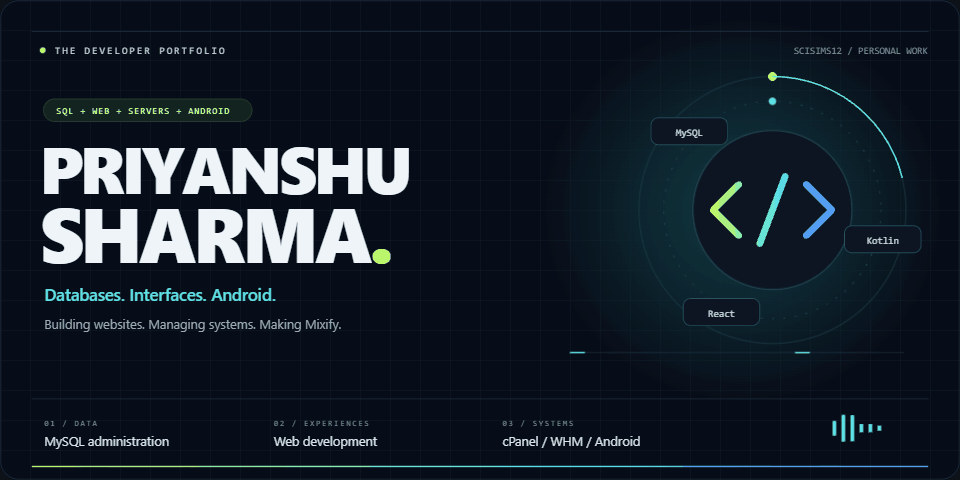
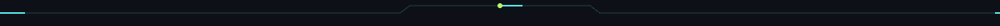
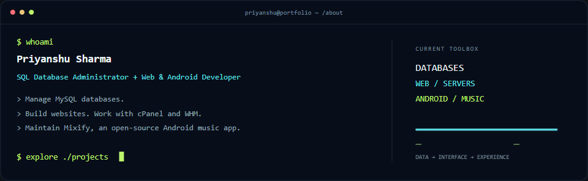
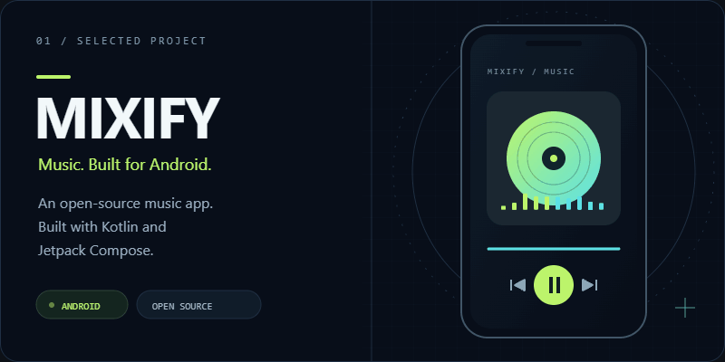
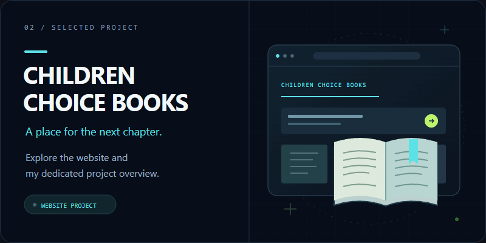
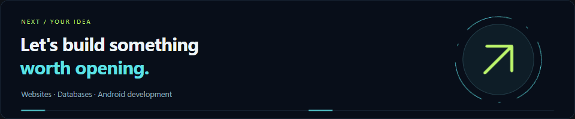

<!-- Keep this README and the assets/ folder together at the repository root. -->

<p align="center">
  <a href="https://portfolio.mixify.co.in/">
    
  </a>
</p>

<p align="center">
  <strong>SQL Database Administrator · Web Developer · Android Developer</strong><br />
  From the database behind the screen to the experience on it.
</p>

<p align="center">
  <a href="https://portfolio.mixify.co.in/"><strong>◉ VISIT PORTFOLIO</strong></a>
  &nbsp; / &nbsp;
  <a href="https://github.com/scisims12"><strong>GITHUB ↗</strong></a>
  &nbsp; / &nbsp;
  <a href="https://www.linkedin.com/in/priyanshu-sharma-a59293241/"><strong>LINKEDIN ↗</strong></a>
  &nbsp; / &nbsp;
  <a href="https://portfolio.mixify.co.in/#contact"><strong>LET'S TALK ↗</strong></a>
</p>

<p align="center"><sub>Prefer a still version? <a href="README-STATIC.md">Read without animations</a>.</sub></p>



## 01 / The person behind the code



I'm **Priyanshu Sharma**, a **SQL Database Administrator and Web & Android Developer**. I manage MySQL databases, build websites, work with cPanel and WHM, and maintain **Mixify**, an open-source Android music app built with Kotlin and Jetpack Compose.

This repository is the source code for my personal portfolio: my background, technical skills, selected projects, and ways to get in touch.

| My workspace | What I work with |
| :--- | :--- |
| **▤ Databases** | MySQL and SQL database administration |
| **⌘ Websites** | React, JavaScript, HTML and Tailwind CSS |
| **⚙ Servers** | Server administration, cPanel and WHM |
| **♫ Android** | Kotlin, Jetpack Compose and Mixify |

<p align="center">
  <a href="https://portfolio.mixify.co.in/#about">About my journey</a> &nbsp; · &nbsp;
  <a href="https://portfolio.mixify.co.in/#skills">Technical skills</a> &nbsp; · &nbsp;
  <a href="https://portfolio.mixify.co.in/#projects">Selected work</a> &nbsp; · &nbsp;
  <a href="https://portfolio.mixify.co.in/#faq">FAQ</a> &nbsp; · &nbsp;
  <a href="https://portfolio.mixify.co.in/#contact">Contact</a>
</p>


## 02 / Selected work

### ♫ Mixify — Android Music App

[](https://portfolio.mixify.co.in/mixify.html)

**An open-source music app, built for Android.**

I maintain Mixify using **Kotlin** and **Jetpack Compose**. Explore the project, browse its source, and read about its origins below.

**[Explore the project ↗](https://portfolio.mixify.co.in/mixify.html)** &nbsp; · &nbsp; [Visit Mixify](https://mixify.co.in/) &nbsp; · &nbsp; [Source code](https://github.com/scisims12/Mixify) &nbsp; · &nbsp; [Project origins & credits](https://github.com/scisims12/Mixify#project-origins)

### ▧ Children Choice Books

[](https://portfolio.mixify.co.in/children-choice-books.html)

**A dedicated showcase of my work for Children Choice Books.**

Visit the project page for an overview of my work, or explore the live website.

**[Explore the project ↗](https://portfolio.mixify.co.in/children-choice-books.html)** &nbsp; · &nbsp; [Visit Children Choice Books](https://www.childrenchoicebooks.com/)

<sub>Project artwork above is illustrative; visit the linked pages for the actual products.</sub>


## 03 / Inside the portfolio

| Experience | Details |
| :--- | :--- |
| **↔ Every screen** | Responsive layouts for desktop, tablet and mobile. |
| **◐ Make it yours** | Light and dark themes with customizable colors. |
| **≈ Built to move** | Scroll animations, hover effects and motion interactions. |
| **▦ Explore the story** | About, skills, projects, FAQ and contact sections. |
| **⊞ A closer look** | Project detail pages and a screenshot gallery with full-size previews. |
| **↗ Stay connected** | EmailJS contact form, plus GitHub and LinkedIn links. |

**[Experience the live portfolio →](https://portfolio.mixify.co.in/)**


## 04 / The stack

```text
INTERFACE       React 19 · JavaScript · HTML
STYLE           Tailwind CSS 4
MOTION          Framer Motion · Typewriter Effect
STATE           Redux Toolkit · React Redux
ICONS           React Icons
CONTACT         EmailJS
BUILD           Vite 6 · ESLint
SHIP            Docker · Nginx
```

> **Two projects, two stacks.** This portfolio is built with **React**. **Kotlin and Jetpack Compose** power the separate **Mixify Android app**.


## 05 / Run it on your machine

Install **Node.js 20**, or a compatible version supported by Vite 6, then run:

```bash
git clone https://github.com/scisims12/my-portfolio.git
cd my-portfolio
npm ci
npm run dev
```

Open the local URL printed by Vite.

### Your command center

| Command | What happens |
| :--- | :--- |
| `npm run dev` | Start the development server. |
| `npm run build` | Generate the production build in `dist/`. |
| `npm run preview` | Preview the production build locally. |
| `npm run lint` | Run ESLint. |

> **Using the contact form in your own project?** Configure your own EmailJS service, template and public key.

### Run with Docker

The included Dockerfile builds the site and serves it with Nginx.

```bash
docker build -t priyanshu-portfolio .
docker run --rm -p 8080:80 priyanshu-portfolio
```

Then open **[localhost:8080](http://localhost:8080)**.

<details>
<summary><strong>▤ Open the project map</strong></summary>

```text
my-portfolio/
├── .github/workflows/       # CI workflows
├── assets/                 # README artwork and animations
├── public/                 # Static website assets
├── src/                    # React source and components
├── index.html              # Portfolio entry page
├── mixify.html             # Mixify project page
├── children-choice-books.html
├── Dockerfile              # Build and Nginx container
├── docker-compose.yml
├── package.json
└── vite.config.js
```

</details>


## 06 / Let's connect

[](https://portfolio.mixify.co.in/#contact)

For **website, database or Android development enquiries**, connect with me on LinkedIn or use the portfolio contact form.

| Find me | Link |
| :--- | :--- |
| **Portfolio** | [portfolio.mixify.co.in](https://portfolio.mixify.co.in/) |
| **GitHub** | [@scisims12](https://github.com/scisims12) |
| **LinkedIn** | [Priyanshu Sharma](https://www.linkedin.com/in/priyanshu-sharma-a59293241/) |
| **Contact** | [Send an enquiry ↗](https://portfolio.mixify.co.in/#contact) |

<p align="center">
  <strong>Thanks for stopping by.</strong><br />
  <sub>Explore the work. Open the source. Start a conversation.</sub>
</p>

<p align="center"><a href="#"><strong>↑ BACK TO TOP</strong></a></p>
